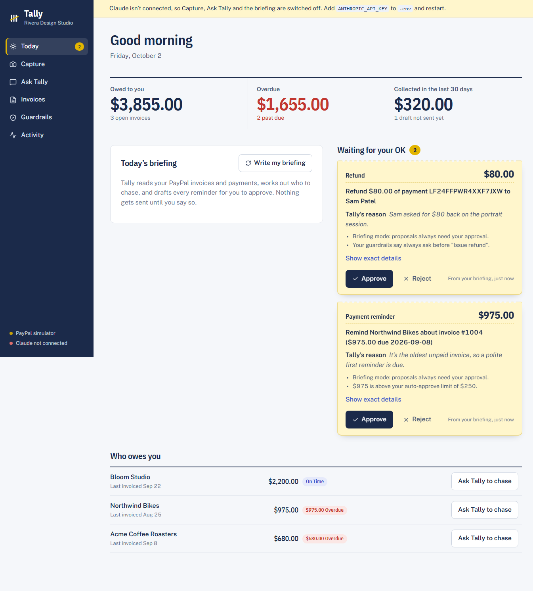

# Tally

**You do the work. Tally gets you paid.**

Tally is an AI back office for solo businesses (designers, tradespeople, tutors, makers) that runs on **PayPal** and **Groq**. Photograph a job sheet or paste a client's email and Tally turns it into a PayPal invoice. Ask it to chase late payers, refund a customer, or set up a retainer and it does the work through PayPal's APIs.

The part that matters: **an AI should not be able to move your money unchecked.** Every action the agent takes goes through a policy engine, written in code and not in the prompt. Small, routine actions run on their own. Anything bigger, riskier, or aimed at someone new arrives on your screen as an **approval slip** showing what the agent wants to do, why, and which rule stopped it. You approve or reject, and the agent picks up exactly where it paused.

Built for the [Build What's Next with PayPal and AI](https://paypalaihackathon.devpost.com/) hackathon.



## Why this exists

Solo business owners lose hours every week to invoicing admin: retyping job sheets, forgetting to chase, working out who owes what. That work is repetitive and well-defined, so it suits an AI agent. It is also all about money, which is why people don't want to hand it over. PayPal's own Agent Toolkit gives an LLM direct access to payment APIs but ships without a human-confirmation gate. Tally is what sits between the model and the money.

## What it does

| Screen | What you get |
|---|---|
| **Today** | Receivables at a glance (owed, overdue, collected), an AI-written daily briefing that proposes reminders for late invoices, and your approval queue. |
| **Capture** | Drop a photo of a job sheet or quote, or paste an email or chat message. A Groq vision model with strict JSON-schema output extracts client, line items, deposit terms and due date, flags what it isn't sure about, and gives you an editable draft. One click sends a real PayPal invoice. |
| **Ask Tally** | A chat agent with 14 PayPal tools: "Who owes me money?", "Chase everyone overdue, nicely", "Invoice Bloom Studio $1,400 net 30", "Refund Sam $80", "Set up a $300/month retainer". Tool calls and approval slips appear inline in the conversation. |
| **Invoices** | An [AG Grid](https://www.ag-grid.com/) ledger of live PayPal invoices and payments with filtering, sorting, and one-click Send / Chase / pay page. |
| **Guardrails** | Set an auto-approve limit, a daily cap, whether new clients need approval, and a per-action rule: *within limits*, *always ask*, or *never*. |
| **Activity** | An audit trail of every tool call, every guardrail decision (with its reasons), every approval, and every PayPal webhook. |

### The approval slip

The approval slip is the product's core idea. When the agent proposes something the policy won't auto-approve, the conversation **suspends** and a slip is created. The slip shows the agent's own reason, the rules that triggered the hold, and the exact parameters. When you decide, the result goes back to the model as the tool result and the turn resumes. If you reject, the model is told so and does not retry.

The same gate protects every entry point: the built-in agent, the daily briefing, and external agents connecting over MCP.

## How it uses PayPal

| PayPal capability | Used for |
|---|---|
| **Invoicing v2**: create, send, remind, cancel, record payment, list | The core billing loop |
| **Orders v2**: create and capture | One-off payment links (deposits, quick sales) |
| **Payments v2**: refund a capture | Full and partial refunds |
| **Catalog Products + Billing Plans + Subscriptions v1** | Recurring retainers |
| **Transaction Search (Reporting v1)** | The payments ledger, and finding payment ids to refund |
| **Webhooks**: `INVOICING.INVOICE.PAID`, `PAYMENT.CAPTURE.COMPLETED`, plus signature verification | Live "client paid" updates |

Everything runs against the **PayPal sandbox**. If you have no keys, Tally runs on a built-in **PayPal simulator** with the same interface: invoice lifecycle, checkout, captures, refunds, transactions, and a simulated payer page.

## How it uses AI

- **Agent loop** (`server/agent/runtime.ts`): `llama-3.3-70b-versatile` on Groq with streaming, tool calling and parallel tool calls over 14 tools. It is a hand-written loop because it has to *suspend mid-turn* for human approval and resume later, possibly after a restart. Auto-approved calls run immediately, gated calls wait, and all results are returned together. Malformed tool calls (HTTP 400 `tool_use_failed`) are retried, and tool arguments are validated with Zod before anything runs.
- **Vision and structured outputs** (`server/ai/extract.ts`): a photo goes to `qwen/qwen3.8-27b` with `strict` JSON-schema output (constrained decoding), and a validated invoice draft comes out with a confidence level and a "check these" list. Known clients are passed in so names are matched to emails. Photos attached in chat are transcribed by the vision model first, because the chat model is text-only. Groq's vision models take images, not PDFs.
- **Daily briefing**: the agent reads the books, proposes a tone-appropriate reminder per overdue invoice (friendly if just due, firmer if long overdue), and writes a short summary. Its proposals are always routed through approval.
- **MCP server** (`server/mcp.ts`): exposes the same guarded tools to any MCP client, such as Claude Desktop or Cursor. External agents get the same limits, and writes beyond them show up in your approval queue.

## Architecture

```
React SPA ──REST + SSE──► Express API (TypeScript)
                              │
        ┌─────────────────────┼──────────────────────┐
        ▼                     ▼                      ▼
  Agent runtime          Extraction             Webhook handler
 (Groq tool loop,       (vision + JSON         (PayPal events →
  pause / resume)        schema output)          UI + audit)
        │
        ▼
   gate()  ──►  Policy engine  ──►  allow → execute
        │         (code, not prompt)  ask   → approval slip ──► human ──► resume
        │                             deny  → blocked result
        ▼
  PayPal gateway interface
    ├─ LivePayPal (sandbox REST, OAuth2)
    └─ MockPayPal (simulator)
```

Design decisions that matter:

- **Policy is code.** `server/policy.ts` is a pure function with unit tests. The model can't argue its way past it.
- **One choke point.** `gate()` in `server/agent/actions.ts` is the only path to a write, whoever is calling.
- **Append-only conversation history**, so thinking blocks stay valid across a pause.
- **A gateway interface** over PayPal, so the same code runs against the sandbox and the simulator.

## Run it

Requires Node 22+.

```bash
npm install
cp .env.example .env     # add GROQ_API_KEY (and optionally PayPal sandbox keys)
npm run dev              # web on http://localhost:5173, API on :8787
```

Or build and serve everything from one port:

```bash
npm run build && npm start     # http://localhost:8787
```

**With no PayPal keys** Tally uses the simulator and seeds a small ledger (paid, sent, overdue and draft invoices). The invoice "Pay page" links open a simulated PayPal payer page, and paying there fires the same webhook handling a real payment would.

**With PayPal sandbox keys**, set `PAYPAL_CLIENT_ID` and `PAYPAL_CLIENT_SECRET` from a sandbox app at <https://developer.paypal.com/dashboard/applications/sandbox>. Invoices are real sandbox invoices, delivered to the sandbox *business* and *personal* accounts. For live payment events, add a webhook for `https://<your-host>/api/webhooks/paypal` to the app, subscribe to `INVOICING.INVOICE.PAID` and `PAYMENT.CAPTURE.COMPLETED`, and set `PAYPAL_WEBHOOK_ID`.

**Without a Groq key**, the dashboard, invoices, guardrails, activity log and approval flow all work. In simulator mode, the **Queue two sample proposals** button on Today lets you try the approval slips without AI. Capture, Ask Tally and the briefing need a key.

### Try this (about two minutes)

1. **Today**: click **Write my briefing**. Tally reviews the books and queues reminders for overdue invoices.
2. **Capture**: click the *Client email* sample, then **Read it into an invoice**. Edit if you like, then send.
3. **Ask Tally**: *"Sam asked for $80 back on his portrait session. Refund it."* A slip appears, because refunds always ask. Approve it and Tally finishes the job.
4. **Guardrails**: set refunds to *Never*, then ask again to see a block.
5. **Invoices**: open a **Pay page**, pay as the client, and watch the invoice flip to Paid and a toast appear.
6. **Activity**: every step above, with reasons.

### Use Tally from other agents (MCP)

With Tally running, add it to an MCP client:

```json
{
  "mcpServers": {
    "tally": {
      "command": "npx",
      "args": ["tsx", "server/mcp.ts"],
      "cwd": "/path/to/tally",
      "env": { "TALLY_URL": "http://localhost:8787" }
    }
  }
}
```

`npm run mcp:test` runs a smoke test that lists the tools, reads your cash position, and attempts a refund (which lands in your approval queue).

### Deploy

`render.yaml` is a Render Blueprint: connect the repo, set the secrets, and set `PUBLIC_URL` to the service URL. The data file lives on Render's ephemeral disk, which is fine for a demo. For production, use a persistent disk or a database.

### Try the agent loop offline

`npm run mock:groq` starts a scripted stand-in for Groq's API. Run Tally with `GROQ_API_KEY=test GROQ_BASE_URL=http://localhost:8899 npm start`, open **Ask Tally**, and send *"Refund Sam $80"*: the agent looks up transactions, asks to refund, and waits on an approval slip.

### Tests

```bash
npm test            # policy engine + the guarded-action gate (14 tests)
npm run typecheck
```

## Project layout

```
server/
  policy.ts            guardrail engine (pure, tested)
  agent/actions.ts     gate(): policy → execute / queue / deny; approvals
  agent/runtime.ts     Groq tool loop with pause/resume, daily briefing
  agent/tools.ts       14 PayPal tools: schemas, descriptions, handlers
  ai/extract.ts        vision + structured-output invoice extraction
  paypal/live.ts       PayPal sandbox REST client
  paypal/mock.ts       PayPal simulator
  mcp.ts               MCP bridge
web/src/               React app (Today, Capture, Ask Tally, Invoices, Guardrails, Activity)
docs/PLAN.md           research notes and implementation plan
```

## Honest limitations

- Built in a short hackathon window. The agent loop, approval pause/resume and MCP bridge were exercised end to end on the PayPal simulator against a scripted stand-in for Groq's API (`npm run mock:groq`); they have not yet run against live Groq. PayPal calls are written against the documented sandbox endpoints and haven't run against the sandbox either.
- The default chat model is a 70B open model, so it is more likely than a frontier model to pick a wrong tool or mangle arguments. That is part of why every write goes through Zod validation and the policy gate. `qwen/qwen3.8-27b` is a Groq *preview* model; if it is retired, set `GROQ_VISION_MODEL` to another vision model.
- State is a JSON file. There is no multi-user auth, so don't expose an instance to the internet with real credentials.
- PayPal's transaction search can lag several hours on new sandbox payments, so the Payments tab can trail the invoice list.
- Money amounts are held as JS numbers rounded to cents. A production system would use integer minor units.

## Tools used

PayPal REST APIs (sandbox) · Groq (Llama 3.3 70B, Qwen 3.8 27B) via the Groq TypeScript SDK · Model Context Protocol SDK · AG Grid · React, Vite, Express, TypeScript, Zod · Render (deploy config)

## License

[MIT](LICENSE)
